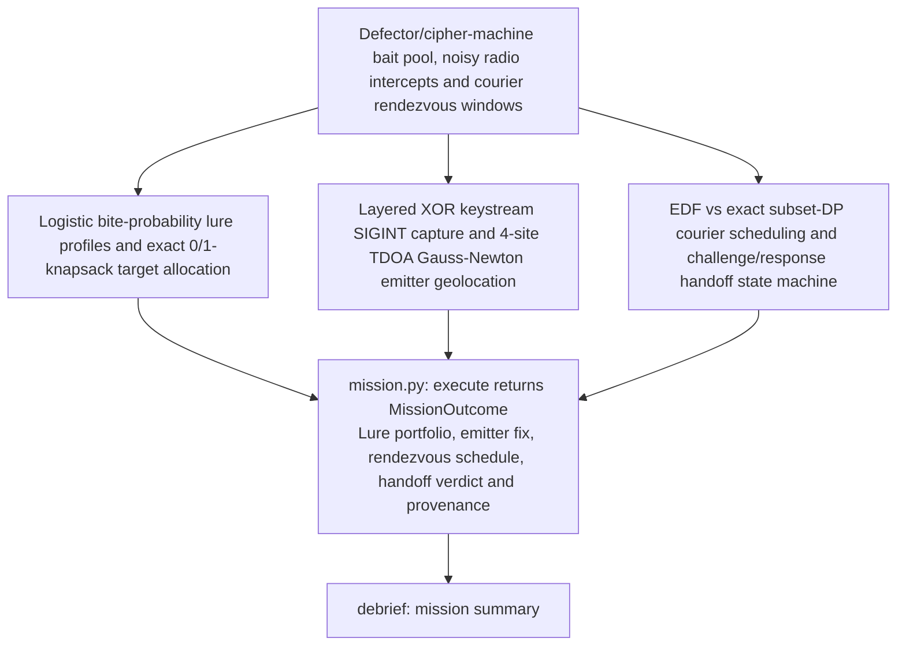

# LURES — From Russia with Love (1963) · PROJECT BOND film package

Mission codename **LURES** implements the operational concepts of *From Russia
with Love* (1963) as a deterministic mission-software package in the PROJECT
BOND suite. The tree is versioned at
`docxology/bond-from_russia_with_love` (default branch `main`).

## Mission model



The branches group implemented capabilities; they do not imply a runtime order.

**Source map:** [`entrapment_engine.py`](src/from_russia_with_love/entrapment_engine.py), [`bait_allocation.py`](src/from_russia_with_love/bait_allocation.py); [`sigint.py`](src/from_russia_with_love/sigint.py), [`direction_finding.py`](src/from_russia_with_love/direction_finding.py); [`courier_schedule.py`](src/from_russia_with_love/courier_schedule.py), [`handoff_protocol.py`](src/from_russia_with_love/handoff_protocol.py), [`scenario.py`](src/from_russia_with_love/scenario.py); [`mission.py`](src/from_russia_with_love/mission.py).

## The film, as a specification

The 1963 film is a deception operation. A fabricated defector and a coveted
cipher machine are used as bait; a radio channel carries the traffic that gives
the operation away; and the plot turns on a handoff that only completes when
both sides produce the right recognition signal. LURES implements that as three
capabilities — **luring**, **listening**, and **handing over** — across six
algorithmic modules.

| Film concept | Module | What it computes |
|---|---|---|
| The honey-trap / bait operation | `entrapment_engine.py` | Bait profile generation and a bounded logistic **bite-probability surface**, plus a validated **trap state machine** (DISARMED → ARMED → BAITED → ENGAGED → SPRUNG / ABORTED) |
| Choosing who to run the lure against | `bait_allocation.py` | Exact **0/1 knapsack** dynamic programming spending a limited lure budget across an analytical target pool, scored against a profit-density greedy baseline |
| The intercepted encoded channel | `sigint.py` | Layered XOR keystream ciphers, additive-Gaussian-noise capture, symbol decision, deciphering, empirical SNR, traffic profiling, and energy-threshold **burst segmentation** |
| Finding the transmitter | `direction_finding.py` | Seeded **TDOA** measurement at four intercept sites and **iterative Gauss–Newton (Taylor-series)** least-squares geolocation (Foy 1976; Torrieri 1984) — *not* the closed-form Chan & Ho 1994 estimator, which this package does not implement |
| Making the meets | `courier_schedule.py` | An **earliest-deadline-first heuristic** for fitting handoff rendezvous into time windows, plus an **exact subset-DP optimum** it is scored against |
| The recognition signal | `handoff_protocol.py` | A meet / challenge / confirm / abort state machine whose confirm code is SHA-256 of call sign + challenge; only an exact confirm reaches HANDOFF, with a red-path abort drill |

Supporting modules: `scenario.py` (the canonical fixed scenario — every
mission constant lives here and nowhere else), `mission.py` (the `bond_api`
adapter), `manuscript_variables.py` (manuscript token hydration), and
`figures/lure_surface.py` + `figures/tdoa_geometry.py`.

All models are analytical and deterministic: no real targeting, no live
signals, no wall-clock dependence. The XOR cipher is pedagogical and is not
cryptography.

### Honest about the hard parts

Two modules solve problems where a cheap answer and a correct answer differ,
and both report the difference rather than assuming it away. The knapsack
allocator ships its greedy baseline alongside the exact solution — and on the
canonical target pool the greedy baseline **ties** the exact solver, so the
manuscript reports that gap as zero and measures the separation on a separate
witness instance (`scenario.GREEDY_WITNESS_TARGETS`) instead of on a tie. The
courier
scheduler's greedy ordering *resembles* the classical optimal interval
scheduling algorithm but is **not** optimal — maximising completed meets with
release times and deadlines is NP-hard — so the package ships an exact subset
dynamic program, reports the gap as a measured quantity, and pins a
counterexample in the test suite where the heuristic provably loses.

## Architecture

- **Pure core** — all six concept modules plus `scenario.py` import stdlib and
  numpy only. No `bond_api`, no infrastructure. A test enforces this by reading
  each module's source.
- **Adapter** — `mission.py` is the only module importing `bond_api`. It
  implements the frozen `MissionProvider` protocol and registers gadgets with
  the `GadgetRegistry`.
- **Thin CLIs** — `scripts/` holds orchestrators only; all logic lives in
  `src/`.

Full module-by-module detail: [`docs/architecture.md`](docs/architecture.md).

## The MissionProvider surface

`src/from_russia_with_love/mission.py` exposes the frozen suite contract:

```python
class MissionProvider:
    film = "from_russia_with_love"
    def brief(self) -> MissionBrief: ...
    def recon(self, request: ReconRequest) -> ReconReport: ...
    def plan(self, brief: MissionBrief) -> MissionPlan: ...
    def execute(self, plan: MissionPlan) -> MissionOutcome: ...
    def debrief(self, outcome: MissionOutcome) -> Debrief: ...

GADGETS: dict[str, object]     # module-level registry payload
def register_gadgets() -> None: ...
```

`execute()` runs all six engines against the canonical scenario and attaches
`Provenance` (package version, seed, input hash). Success requires four
independent conditions: exact plaintext recovery, the handoff reaching
`handoff`, TDOA error below 0.5 receiver coordinate units, and at least one
scheduled meet.

**This shape is consumed across packages** by `bond-cli`, the coordinator's
reconcile pass and the orchestrator. Deepen inside the package; do not rename
the class, change a stage signature, or change `GADGETS` from a module-level
dict.

## Getting started

```bash
cd /path/to/from_russia_with_love   # this package's root
uv sync --extra dev            # dev tools; bond-api is vendored in the tree
uv run pytest tests/ --cov=src --cov-fail-under=90
uv run python scripts/00_preflight.py
uv run python scripts/run_mission.py run "assess the LURES cover posture"
uv run python scripts/z_generate_manuscript_variables.py  # -> output/data + figures
```

## Gates

```bash
uv run pytest tests/ --cov=src --cov-fail-under=90
uv run ruff check src/ scripts/ tests/
uv run ruff format --check src/ scripts/ tests/
uv run mypy src/ scripts/
uv run python scripts/00_preflight.py      # pure-core + wired-protocol sanity
rg -n "template[_]code_project" .          # expect zero hits
```

The coverage gate is a 90% line-and-branch floor on `src/`; the suite runs
comfortably above it. Measured figures from the last verification run — test
count and coverage percentage — are recorded in
[`docs/_generated/COUNTS.md`](docs/_generated/COUNTS.md) rather than quoted
here, so this file cannot go stale.

## Documentation

- [`docs/agent_instructions.md`](docs/agent_instructions.md) — operational
  constraints and the verify-before-done checklist
- [`docs/architecture.md`](docs/architecture.md) — module-by-module design
- [`docs/testing_philosophy.md`](docs/testing_philosophy.md) — no-mock,
  real-data, positive-controlled testing doctrine
- [`AGENTS.md`](AGENTS.md) — build/test/verify instructions
- [`TODO.md`](TODO.md) — remaining work and declared integration points
- `manuscript/` — the package's paper; all metrics arrive as generated tokens

The frozen protocol lives in `vendor/bond-api/` — a copy of the `bond-api`
repository carried in this tree and wired as a local path dependency in
`pyproject.toml`. `scripts/vendor.py --check` re-verifies every copied file
offline, so the copy cannot drift without failing the gate.
